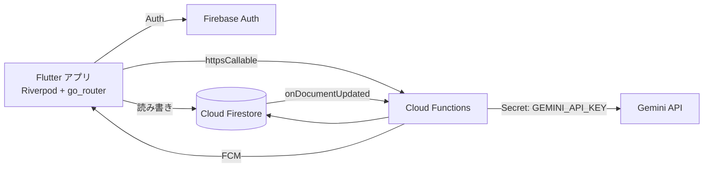

# EduPlanner AI

[](https://github.com/okiljon04344/eduplaner_ai/actions/workflows/ci.yml)


[日本語](#日本語) ・ [English](#english) ・ [O'zbekcha](#ozbekcha)

---

## 日本語

### 概要
時間割・課題・勉強のモチベーションを 1 つのアプリで管理できる学習プランナーです。
生成 AI（Gemini API）を **Cloud Functions 経由** で呼び出し、API キーはアプリに埋め込まず、サーバー側で保持します。

### 主な機能
| 機能 | 内容 |
|---|---|
| 時間割 | 曜日ごとの授業 CRUD、週切り替え、休講などのステータス変更通知 |
| 課題管理 | 締切・優先度・フィルター、期限が近い課題のバッジ表示 |
| ホーム | 週ごとの進捗グラフ（`fl_chart`）、苦手分野カード |
| AI チューター | Gemini と学習相談チャット（`chatWithTutor`） |
| テスト問題生成 | 科目・範囲からクイズを自動生成（`generateQuiz`）、苦手分野の分析（`analyzeWeakArea`） |
| 課題の AI フィードバック | 提出物を AI が分析（`analyzeAssignmentSubmission`） |
| グループ | 招待コードでクラスに参加（`joinGroupByCode`） |
| 通知 | FCM プッシュ通知 + ローカルリマインダー |
| 多言語 | 日本語・英語・ウズベク語など **21 言語** |
| アカウント | Google ログイン、アカウント削除（`deleteAccount`） |

### 技術スタック
- **アプリ:** Flutter / Dart, Riverpod（`riverpod_annotation`）, go_router, Material 3
- **バックエンド:** Firebase Auth, Cloud Firestore, Cloud Functions (v2), Firebase Cloud Messaging, Analytics
- **AI:** Gemini API（`gemini-flash-latest`）— キーは Cloud Functions の Secret（`GEMINI_API_KEY`）で管理
- **コード生成:** freezed, json_serializable, build_runner
- **品質:** `flutter analyze` 警告 0 件、ウィジェット / ユニットテスト 118 件

### アーキテクチャ


### フォルダ構成
```
lib/
  core/       テーマ・ルーター・定数・通知サービス
  shared/     共通ウィジェット
  features/   auth, onboarding, landing, home, timetable, assignments,
              ai_chat, quiz, groups, settings
functions/    Cloud Functions（Node.js）
firestore.rules  セキュリティルール
```

### セットアップ
```bash
flutter pub get
dart run build_runner build --delete-conflicting-outputs

# Firebase（自分のプロジェクトで）
flutterfire configure

# Cloud Functions
cd functions && npm install
firebase functions:secrets:set GEMINI_API_KEY
firebase deploy --only functions,firestore:rules
```

#### Cloud Vision API & 予算アラート設定（課題画像の個人情報自動黒塗り）
`analyzeAssignmentSubmission` は画像（JPG/PNG/WebP）内の氏名・連絡先を自動黒塗りするため Google Cloud Vision API（`DOCUMENT_TEXT_DETECTION`）を使用します。デプロイ前に GCP コンソールで以下を設定してください：

1. **Cloud Vision API を有効化**
   ```bash
   gcloud services enable vision.googleapis.com --project=<YOUR_PROJECT_ID>
   ```
2. **Cloud Functions 実行サービスアカウントの権限確認**
   - 通常はデフォルトのサービスアカウント（`<PROJECT_NUMBER>-compute@developer.gserviceaccount.com` または `<PROJECT_ID>@appspot.gserviceaccount.com`）がそのまま Vision API を呼び出せます。
   - 最小権限のカスタムサービスアカウントを使用する場合は、IAM で **`roles/cloudvision.user`**（または Vision API 呼び出し権限を含むロール）を付与してください。
3. **GCP 予算アラート（Billing Budget Alert）の設定**
   - Google Cloud Console → **お支払い（Billing）→ 予算とアラート（Budgets & alerts）** を開き、月額予算と通知しきい値（例: 50%, 90%, 100%）を設定してください（Vision API の無料枠超過による想定外課金を防ぐため）。

#### Firestore TTL ポリシー設定（時間割インポート・ポリシー履歴の自動削除）
以下のサーバー専用コレクションには期限日時フィールド `expiresAt`（Firestore Timestamp）が書き込まれます。デプロイ後、Firestore コンソール（**Firestore → 存続期間（TTL）**）または以下の `gcloud` コマンドで TTL ポリシーを有効化してください：

| コレクション | TTL フィールド | 保持期間 | 用途 |
|---|---|---|---|
| `timetable_import_drafts` | `expiresAt` | 30 分 | プレビュー済み一時ドラフト |
| `timetable_import_history` | `expiresAt` | 30 日 | インポート取り消し（Undo）スナップショット |
| `school_policy_history` | `expiresAt` | 365 日 | 学校ポリシー変更の監査ログ |

```bash
gcloud firestore fields ttls update expiresAt --collection-group=timetable_import_drafts --enable-ttl --project=<YOUR_PROJECT_ID>
gcloud firestore fields ttls update expiresAt --collection-group=timetable_import_history --enable-ttl --project=<YOUR_PROJECT_ID>
gcloud firestore fields ttls update expiresAt --collection-group=school_policy_history --enable-ttl --project=<YOUR_PROJECT_ID>
```

#### Privacy Regex Engine Note
- `policy.privacy.studentIdPatterns` は `validateSafeRegexPattern` による ReDoS 静的検証と 6,000 文字ウィンドウ制限で保護されています（RE2 ネイティブ導入は将来検討 / RE2 keyinroq ko'rib chiqiladi）。

#### AI プロバイダー設定・予算保護・Gemini 無料枠バックアップポリシー
Cloud Functions は `privacy/safe_ai.js`（`callAiSafely`）経由で **Claude（プライマリ）+ Gemini 無料枠（許可タスクのみのバックアップ）** に対応しています。

1. **タスク別フォールバック制御 (`AI_TASK_CONFIG.allowFallbackToFreeTier`):**
   - `true`（フォールバック／予算 100% 時に Gemini 無料枠へ切替可）: `aiStudyTip`, `analyzeWeakArea`, `chatWithTutor`, `generateQuiz`, `generateQuiz:grounding`
   - `false`（Gemini 無料枠へ絶対フォールバックしない）: `analyzeAssignmentSubmission`, `previewTimetableImport`
     - Claude 一時エラー時は `ai_temporarily_unavailable`（日次クォータ自動返却）、月次予算 100% 到達時は `ai_budget_exceeded` を返します。
2. **Gemini API キーは必ず「課金無効（Billing なし）の別 Google Cloud プロジェクト」で作成:**
   - [Gemini API Additional Terms of Service](https://ai.google.dev/gemini-api/terms)（2026年3月23日発効）により、有効な Cloud Billing アカウントが紐づいたプロジェクト経由の API 呼び出しは **Paid Services（有料枠 / Tier 1 以上）** として課金対象になります。無料枠バックアップを維持するため、`GEMINI_API_KEY` は Firebase 本番（Blaze）プロジェクトとは別の **Billing 未設定 GCP プロジェクト** で発行してください。
3. **Gemini 無料枠（Unpaid Services）のデータ利用規約とレート制限:**
   - **データ利用規約 ([Gemini API Additional Terms](https://ai.google.dev/gemini-api/terms#unpaid-services)):** 欧州経済領域（EEA）・スイス・英国以外の地域では、無料枠（Unpaid Services）に送信されたプロンプト・システム指示・ファイルおよび生成応答が Google の製品・サービス・ML 技術の改善に使用され、人間のレビュアーにより閲覧・注釈付けされる場合があります（アカウントや API キーからは切り離されます）。機密・個人情報を含むタスク（`analyzeAssignmentSubmission`, `previewTimetableImport`）で無料枠フォールバックを禁止している理由はこのためです。また EEA・スイス・英国のユーザー向けには Paid Services のみ使用可能です。
   - **無料枠 RPM / RPD レート制限 ([Gemini API Rate Limits](https://ai.google.dev/gemini-api/docs/rate-limits)):** Google の公式ドキュメントではモデル別の静的 RPM/RPD 一覧表が廃止されており、プロジェクトごとの正確な最新上限（RPM / TPM / RPD）は [Google AI Studio Rate Limits](https://aistudio.google.com/rate-limit) で確認する必要があります。公式仕様として、クォータは API キー単位ではなく **Google Cloud プロジェクト単位** で適用され、**RPD は太平洋時間（PT）の午前 0 時にリセット** されます（プレビュー・実験モデルはより厳しい上限が適用）。
   - Gemini から `429` が返された場合、サーバーは **1 回のみリトライ** し、失敗時は `ai_temporarily_unavailable` を返します。
4. **Anthropic Console の利用上限 & サーバー側予算保護 (`AI_MONTHLY_BUDGET_USD`):**
   - Claude API を利用する前に、必ず [Anthropic Console — Limits](https://platform.claude.com/settings/limits) で月額利用上限（Spend Limit）を設定してください。
   - `ai_usage_monthly/{yyyymm}/models/{provider_model}` にトークン数と `web_search` 回数のみを原子的に集計します（プロンプト・回答・個人情報は保存しません）。
   - `AI_MONTHLY_BUDGET_USD > 0` の場合、80% 到達時に警告ログを 1 回記録し、100% 到達時は月末（UTC）まで許可タスクを Gemini へ切り替え、不許可タスクは `ai_budget_exceeded` で停止します。
5. **Claude キー登録後は最初にスモークテストを実行:**
   ```bash
   cd functions
   npm run ai:keys -- set claude --local
   npm run ai:smoke -- --provider=claude
   ```
   - `ai:smoke` は `AI_TASK_CONFIG` の全タスクを最小入力で 1 回ずつ検証し、ステータス・遅延・トークン数のみ表示します（AI 応答本文は表示しません）。
6. **共有 JSON 同期 (`shared/`):**
   - `shared/error_reasons.json` と `shared/school_policy_defaults.json` が唯一の原本（Single Source of Truth）です。変更時は `cd functions && npm run sync-shared` を実行してください（Node / Dart 双方のテストが差分を自動検出します）。

### 実行・テスト
```bash
flutter run            # 接続中のデバイスで起動
flutter run -d chrome  # Web
flutter analyze
flutter test
cd functions && npm test && npm run lint && npm run test:rules
```

---

## English

**EduPlanner AI** is a Flutter study planner.
It combines a timetable, assignment tracker, weekly progress charts and an AI tutor.
All AI calls go through **Firebase Cloud Functions** (`callAiSafely`), supporting Gemini and Claude without shipping API keys in the client app.

**Highlights**
- Timetable & assignment CRUD with deadline badges and reminders
- AI tutor chat, quiz generation, weak-area analysis and AI feedback on submissions
- Class groups via invite codes, FCM push notifications
- 21 UI languages
- Riverpod + go_router architecture, automated tests, no `flutter analyze` errors/warnings

**AI Key & Budget Safety:** Before enabling Claude (`AI_PROVIDER=claude`), set a monthly spend limit in [Anthropic Console](https://platform.claude.com/settings/limits), configure `AI_MONTHLY_BUDGET_USD` and optional `AI_FALLBACK_PROVIDER`, and run the smoke test first (`cd functions && npm run ai:smoke -- --provider=claude`). Manage keys via `npm run ai:keys -- help`.

---

## O'zbekcha

**EduPlanner AI** — Flutter'da yozilgan o'quv rejalashtiruvchi ilova.

- Dars jadvali, topshiriqlar, haftalik progress grafigi
- AI yordamchi (Gemini va Claude): chat, test savollari generatsiyasi, zaif mavzularni tahlil qilish
- API kalitlari ilova ichida **saqlanmaydi**: so'rovlar Cloud Functions (`callAiSafely`) orqali yuboriladi, kalitlar esa Secret Manager'da (`GEMINI_API_KEY`, `ANTHROPIC_API_KEY`) turadi
- 21 ta til, Google login, push bildirishnomalar

### AI kalitlarini boshqarish (Gemini & Claude)

Rasmiy kalitlarni olish:
- Gemini API kaliti: [Google AI Studio](https://aistudio.google.com/)
- Claude API kaliti: [Anthropic Console](https://platform.claude.com/)
- **Muhim:** Claude kalitini ishlatishdan oldin [Anthropic Console — Spend Limits](https://platform.claude.com/settings/limits) sahifasida oylik sarf limitini (Spend Limit) albatta o'rnating.

Kalitlarni va provayderni terminaldan xavfsiz boshqarish (`functions/` papkasidan):

```bash
cd functions

# 1. Holatni ko'rish (loyiha ID, faol provayder, byudjet, lokal/cloud kalitlar)
npm run ai:keys -- status

# 2. Lokal emulyator/test uchun kalit kiritish (yashirin prompt; .secret.local gitga kirmaydi)
npm run ai:keys -- set claude --local

# 3. Firebase Secret Manager (Cloud) ga kalit saqlash (stdin orqali, tarixga tushmaydi)
npm run ai:keys -- set claude

# 4. Claude kalitini qo'shgandan keyin birinchi bo'lib smoke test'ni ishga tushiring:
npm run ai:smoke -- --provider=claude

# 5. Faol provayderni almashtirish (functions/.env yangilanadi)
npm run ai:keys -- provider claude

# 6. Eski/keraksiz cloud secret versiyalarini tozalash yoki faol bo'lmagan kalitni o'chirish
npm run ai:keys -- prune
npm run ai:keys -- remove claude
```

- **Qayta deploy eslatmasi:** Cloud Secret yoki `.env` (`AI_PROVIDER`, `AI_FALLBACK_PROVIDER`, `AI_MONTHLY_BUDGET_USD`) o'zgargandan keyin kuchga kirishi uchun `firebase deploy --only functions` bajaring.
- **Asosiy provayder va Free-tier zaxira qoidasi (`allowFallbackToFreeTier`):**
  - Asosiy provayder — **Claude**; **Gemini (Free Tier)** faqat ruxsat etilgan vazifalar uchun zaxira sifatida ishlatiladi:
    - Ruxsat (`true`): `aiStudyTip`, `analyzeWeakArea`, `chatWithTutor`, `generateQuiz`, `generateQuiz:grounding`.
    - Taqiqlangan (`false`): `analyzeAssignmentSubmission` (rasm / talaba javobi), `previewTimetableImport` (dars jadvali importi). Claude vaqtinchalik xato bersa, fallback qilinmaydi — `ai_temporarily_unavailable` qaytadi va kunlik kvota qaytariladi.
- **Byudjet 100% himoyasi (`AI_MONTHLY_BUDGET_USD`):**
  - 80% da ogohlantirish logi bir marta yoziladi; 100% da UTC oy tugaguncha ruxsat etilgan vazifalar Gemini ga o'tadi, taqiqlangan vazifalar (`analyzeAssignmentSubmission`, `previewTimetableImport`) esa `ai_budget_exceeded` bilan to'xtatiladi.
- **Gemini Free Tier cheklovlari va `429` qayta urinishi:**
  - Gemini `429` qaytarsa, server **faqat 1 marta** qayta urinadi, so'ng `ai_temporarily_unavailable` qaytaradi.
  - Rasmiy [Gemini API Rate Limits](https://ai.google.dev/gemini-api/docs/rate-limits) hujjatiga ko'ra, Google statik model-bo'yicha Free Tier RPM/RPD jadvallarini hujjatdan olib tashlagan: loyihangizdagi jonli **RPM / TPM / RPD** limitlarini bevosita [Google AI Studio Rate Limits](https://aistudio.google.com/rate-limit) sahifasidan tekshiring. Rasmiy qoidalar: limitlar API kalitga emas, **Google Cloud loyihasiga** bog'lanadi; **RPD Tinch okeani vaqti (midnight Pacific Time)** bo'yicha yangilanadi; preview/eksperimental modellar cheklovlari qattiqroq (Grounding with Google Search uchun Gemini 3+ da standart loyiha limiti — 1,500 RPD).
- **MUHIM — Gemini kaliti va bepul tarif shartlari:**
  - `GEMINI_API_KEY` **billing yoqilmagan alohida Google Cloud loyihasida** yaratilishi shart! Aks holda (agar billing ulangan Firebase/GCP loyihasida yaratilsa), Gemini API avtomatik **Paid Services (Tier 1+)** pullik tarifida ishlaydi.
  - Bepul tarif (**Unpaid Services**) ma'lumotlardan foydalanish shartlari ([Gemini API Additional Terms of Service](https://ai.google.dev/gemini-api/terms)): Yevropa Iqtisodiy Hududi (EEA), Shveytsariya va Buyuk Britaniyadan tashqarida yuborilgan promptlar, tizim ko'rsatmalari, fayllar va javoblar Google mahsulotlari hamda ML texnologiyalarini yaxshilash uchun ishlatilishi va inson moderatorlar (akkaunt/loyihadan ajratilgan holda) tomonidan ko'rib chiqilishi mumkin. Shu sababli maxfiy/talaba fayllari (`analyzeAssignmentSubmission`, `previewTimetableImport`) hech qachon bepul tarifga yuborilmaydi. EEA/Shveytsariya/Buyuk Britaniya foydalanuvchilari uchun faqat Paid Services ruxsat etiladi.
- **Shared JSON sinxronligi:** `shared/*.json` fayllari yagona manba (source of truth) hisoblanadi; tahrirdan so'ng `cd functions && npm run sync-shared` ni bajaring.

---

© 2026 Okiljon Nabiev — [Portfolio](https://okiljon04344.github.io) ・ [GitHub](https://github.com/okiljon04344)
