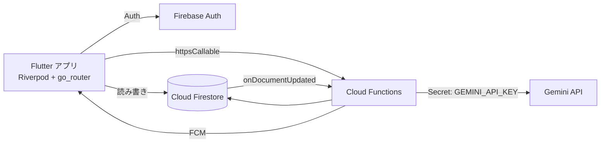

# EduPlanner AI

[](https://github.com/okiljon04344/eduplaner_ai/actions/workflows/ci.yml)


[日本語](#日本語) ・ [English](#english) ・ [O'zbekcha](#ozbekcha)

---

## 日本語

### 概要
時間割・課題・勉強のモチベーションを 1 つのアプリで管理できる学習プランナーです。
生成 AI（Gemini API）を **Cloud Functions 経由** で呼び出し、API キーをアプリに埋め込まない安全な構成にしています。

### 主な機能
| 機能 | 内容 |
|---|---|
| 時間割 | 曜日ごとの授業 CRUD、週切り替え、休講などのステータス変更通知 |
| 課題管理 | 締切・優先度・フィルター、期限が近い課題のバッジ表示 |
| ホーム | 週ごとの進捗グラフ（`fl_chart`）、AI からのひとことアドバイス |
| AI チューター | Gemini と学習相談チャット（`chatWithTutor`） |
| テスト問題生成 | 科目・範囲からクイズを自動生成（`generateQuiz`）、苦手分野の分析（`analyzeWeakArea`） |
| 課題の AI フィードバック | 提出物を AI が分析（`analyzeAssignmentSubmission`） |
| グループ | 招待コードでクラスに参加（`joinGroupByCode`） |
| 通知 | FCM プッシュ通知 + ローカルリマインダー |
| 多言語 | 日本語・英語・ウズベク語など **21 言語** |
| アカウント | Google ログイン、アカウント削除（`deleteAccount`） |

### 技術スタック
- **アプリ:** Flutter / Dart, Riverpod（`riverpod_annotation`）, go_router, Material 3
- **バックエンド:** Firebase Auth, Cloud Firestore, Cloud Functions (v2), Firebase Cloud Messaging, Analytics
- **AI:** Gemini API（`gemini-flash-latest`）— キーは Cloud Functions の Secret（`GEMINI_API_KEY`）で管理
- **コード生成:** freezed, json_serializable, build_runner
- **品質:** `flutter analyze` 警告 0 件、ウィジェット / ユニットテスト 118 件

### アーキテクチャ


### フォルダ構成
```
lib/
  core/       テーマ・ルーター・定数・通知サービス
  shared/     共通ウィジェット
  features/   auth, onboarding, landing, home, timetable, assignments,
              ai_chat, quiz, groups, settings
functions/    Cloud Functions（Node.js）
firestore.rules  セキュリティルール
```

### セットアップ
```bash
flutter pub get
dart run build_runner build --delete-conflicting-outputs

# Firebase（自分のプロジェクトで）
flutterfire configure

# Cloud Functions
cd functions && npm install
firebase functions:secrets:set GEMINI_API_KEY
firebase deploy --only functions,firestore:rules
```

### 実行・テスト
```bash
flutter run            # 接続中のデバイスで起動
flutter run -d chrome  # Web
flutter analyze
flutter test
```

---

## English

**EduPlanner AI** is a Flutter study planner built as a graduation research project at a Japanese IT vocational school.
It combines a timetable, assignment tracker, weekly progress charts and an AI tutor.
All Gemini calls go through **Firebase Cloud Functions**, so the API key never ships inside the app.

**Highlights**
- Timetable & assignment CRUD with deadline badges and reminders
- AI tutor chat, quiz generation, weak-area analysis and AI feedback on submissions
- Class groups via invite codes, FCM push notifications
- 21 UI languages
- Riverpod + go_router architecture, 118 automated tests, zero analyzer warnings

**Quick start:** see the *セットアップ* section above (same commands).

---

## O'zbekcha

**EduPlanner AI** — yapon IT kasb-hunar maktabi talabalari uchun Flutter'da yozilgan o'quv rejalashtiruvchi ilova (bitiruv ishi).

- Dars jadvali, topshiriqlar, haftalik progress grafigi
- Gemini AI yordamchi: chat, test savollari generatsiyasi, zaif mavzularni tahlil qilish
- Gemini API key ilova ichida **saqlanmaydi**: so'rovlar Cloud Functions orqali yuboriladi, key esa `GEMINI_API_KEY` Secret sifatida server'da turadi
- 21 ta til, Google login, push bildirishnomalar

O'rnatish buyruqlari yuqoridagi *セットアップ* bo'limida.

---

© 2026 Okiljon Nabev — [Portfolio](https://okiljon04344.github.io) ・ [GitHub](https://github.com/okiljon04344)
